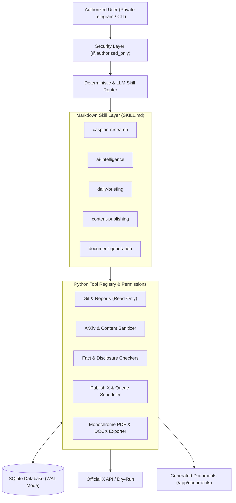

# Project Caspian — Research Communications Agent (`caspian-communication-bot`)

[](https://www.python.org/downloads/)
[](LICENSE)
[]()
[]()
[]()

Autonomous, security-hardened research communication agent and intelligence engine designed specifically for **Project Caspian** (Artificial Ontological Intelligence & World Models). 

Built according to the **AI-Driven Development Specification (v2.0)** with **pure Python and file-based Markdown skills**—strictly free from heavyweight, opaque orchestration frameworks (no LangChain, CrewAI, or AutoGen).

---

## 1. System Architecture

The agent coordinates user interactions from a private Telegram bot, executes deterministic or LLM-assisted routing across modular skill specifications, runs isolated Python tools under granular security scopes, and stores persistent state in SQLite WAL mode.



---

## 2. Core Capabilities & Skills

Every skill follows an explicit, strict **11-section specification contract**:

| Skill | Primary Responsibility | Key Tools | Trigger Examples |
|---|---|---|---|
| **Caspian Research** | Monitors Caspian repository, parses experiment reports, validates disclosure boundaries, and extracts findings. | `scan_repository`, `get_commit_details`, `extract_reports`, `check_disclosure` | `"check caspian"`, `"latest caspian research"`, `"scan repository"` |
| **External AI Intelligence** | Ingests arXiv preprints and research feeds, strips prompt injection vectors, classifies research, and stores persistent knowledge. | `fetch_sources`, `extract_content`, `classify_research`, `deduplicate`, `save_knowledge` | `"find ai research"`, `"latest ai developments"`, `"research papers"` |
| **Daily AI Briefing** | Synthesizes plain-English morning briefings, ranks significance, connects to Caspian phases, and delivers to Telegram. | `fetch_sources`, `search_knowledge`, `retrieve_context`, `deduplicate` | `"daily ai updates"`, `"ai briefing"`, `"what happened in ai today"` |
| **Content Publishing** | Generates 280-char posts and numbered threads, verifies facts against source claims, binds cryptographic approval hashes, and publishes to X. | `generate_post`, `generate_thread`, `verify_claims`, `publish_x`, `queue_post`, `create_schedule` | `"write a post"`, `"generate a thread"`, `"approve draft <id>"`, `"publish draft <id>"` |
| **Document Generation** | Compiles research summaries, reports, and briefings into publication-grade monochrome PDF and DOCX files. | `create_document`, `format_document`, `export_pdf`, `export_docx` | `"create research report"`, `"export briefing to pdf"`, `"save as docx"` |

---

## 3. Strict Security & Governance

1. **Read-Only Caspian Repository Access:** Tools only inspect commits and read research files; writing to or modifying the Caspian research repository is strictly impossible.
2. **Untrusted External Data Sanitization:** All external web/arXiv abstracts are filtered to disarm prompt injection attacks (`"ignore previous instructions"`, system prompts, script injection).
3. **Cryptographic Approval Binding:** User approvals are irreversibly bound to `SHA-256(content)`. Any modification to approved content invalidates the approval status immediately.
4. **Guaranteed Double-Publishing Prevention:** Database uniqueness constraints on `(platform, content_hash)` and `(platform, draft_id)` guarantee no post can be published twice, even across network failures or container restarts.
5. **Secret Redaction Filter:** A custom `SecretRedactingFilter` and `JSONFormatter` scrub Google API keys, Telegram tokens, and OAuth bearer tokens from terminal logs and persisted records.
6. **Disclosure Policy Enforcement:** All Caspian research items default to `REVIEW_REQUIRED` unless explicitly tagged `<!-- DISCLOSURE: PUBLIC -->`. Confidential items and private credentials are automatically blocked from publishing.

---

## 4. Monochrome Visual Design System

All generated documents, summaries, and reports adhere strictly to the **Section 7 Monochrome Visual Identity**:

| Element | Hex Color | Role |
|---|---|---|
| **Document Background** | `#FFFFFF` | Pure white background |
| **Primary Text & Headings** | `#111111` | Jet black typography |
| **Secondary Headings & Metadata** | `#666666` | Clean dark grey |
| **Muted Annotations & Footers** | `#888888` | Footers, timestamps, running headers |
| **Dividers & Table Borders** | `#D9D9D9` | 0.5pt subtle separation lines |
| **Surfaces & Table Headers** | `#F4F4F4` | Light grey callouts and table headers |
| **Dark Accents** | `#181818` | Dark contrast elements (with `#FFFFFF` text) |

*Colourful accents, gradients, badges, or decorative styling are strictly prohibited.*

- **PDF Generation:** Powered by ReportLab using custom two-pass dynamic pagination (`NumberedCanvas`), 0.75-inch margins, and styled tables.
- **DOCX Generation:** Powered by `python-docx` with XML-level cell shading (`#F4F4F4`), custom borders (`#D9D9D9`), and running headers/footers.

---

## 5. Intersection with Project Caspian

The communication bot is built to interface directly with the **Project Caspian** research repository:

```text
Project Caspian Research Repo (e.g. /path/to/caspian)
  ├── docs/
  │   ├── CSP-P2-E001.docx           <-- Extracted & verified by bot
  │   ├── phase<N>/
  │   │   ├── EXPERIMENT_REGISTRY.md <-- Pre-registration commit monitoring
  │   │   └── OPERATIONAL_RECORD.md  <-- Confirmatory seeds & hashes
  └── branch-governance.md           <-- Branch rule compliance (research/*, feature/*)
```

- **Branch Governance Awareness:** Monitors `research/*` and `feature/*` branches for confirmed milestones.
- **Report Ingestion:** Extracts hypotheses, findings, and limitations from `CSP-P<N>-E001.docx` and experiment notes without altering research files.
- **External Relevance Matching:** Correlates external AI research (world models, latent planning, multi-agent reasoning) with Caspian's active research phase.

---

## 6. Installation & Configuration

### Prerequisites
- Python 3.12+ (tested through 3.14)
- Git

### Setup
```bash
# Clone the repository
git clone https://github.com/henshawmike/caspian-communication-bot.git
cd caspian-communication-bot

# Create and activate virtual environment
python3 -m venv .venv
source .venv/bin/activate

# Install dependencies
pip install -r requirements.txt
pip install -r requirements-dev.txt
```

### Environment Configuration
Copy `.env.example` to `.env` and populate your credentials:

```bash
cp .env.example .env
```

```ini
# OpenRouter API (Primary LLM)
OPENROUTER_API_KEY="your-openrouter-api-key"
OPENROUTER_MODEL="baidu/ernie-5.5-flash-preview"
OPENROUTER_API_URL="https://openrouter.ai/api/v1/chat/completions"

# Alternative LLM Providers (Optional fallbacks)
# HF_TOKEN="your-hugging-face-token"
# GEMINI_API_KEY="your-gemini-api-key"

# Telegram Bot
TELEGRAM_BOT_TOKEN="your-bot-token"
TELEGRAM_AUTHORIZED_USER_ID="your-telegram-id"

# X (Twitter) API
X_API_KEY="your-x-api-key"
X_API_SECRET="your-x-api-secret"
X_ACCESS_TOKEN="your-x-access-token"
X_ACCESS_TOKEN_SECRET="your-x-access-token-secret"
X_DRY_RUN_MODE="true"  # Set to "false" for live posting

# Repository & Storage Paths
CASPIAN_REPO_PATH="/path/to/Project_Caspian"
DATABASE_PATH="data/caspian.db"
LOG_LEVEL="INFO"
```

---

## 7. Running the Application

### 1. Interactive Diagnostic CLI
Test the agent without connecting to Telegram:
```bash
.venv/bin/python3 main.py --cli
```
*Allows typing natural-language prompts directly (e.g. `check caspian`, `find ai research on world models`, `write a post`, `export briefing to pdf`).*

### 2. Private Telegram Bot & Background Worker
Start the Telegram interface with continuous background polling:
```bash
.venv/bin/python3 main.py
```

### 3. Standalone Background Scheduler
Run only the automated scheduling worker (for multi-container setups):
```bash
.venv/bin/python3 main.py --worker-only
```

---

## 8. Cloud Deployment with Docker

The agent is containerized for zero-maintenance 24/7 cloud deployment:

```bash
# Build and start container in background
docker compose up -d --build

# Monitor live operational logs
docker compose logs -f caspian-agent

# Check automated container health status
docker inspect --format='{{json .State.Health}}' caspian-agent | jq
```

### Persistent Volume Mapping
- `./data`: Stores `caspian.db` in SQLite WAL mode.
- `./documents`: Destination for exported monochrome PDF and DOCX reports.
- `./logs`: Persistent JSON audit logs with credentials redacted.

Detailed deployment, backup, and disaster recovery procedures are documented in [docs/DEPLOYMENT_AND_RECOVERY.md](file:///home/henshawmike/Projects/Caspian_communication_bot/docs/DEPLOYMENT_AND_RECOVERY.md).

---

## 9. Testing & Quality Assurance

Run the comprehensive unit and integration test suite:

```bash
# Run all tests with coverage
.venv/bin/pytest --cov=agent --cov=database --cov=tools --cov=telegram_bot --cov=scripts

# Run a specific workflow test
.venv/bin/pytest -v tests/test_document_workflow.py
```

**Results:** 97 passing tests across 24 test suites with **88% test coverage**.

---

## 10. Repository Directory Structure

```text
caspian-communication-bot/
├── agent/                   # Core agent orchestration
│   ├── background_runner.py # Continuous background scheduler & briefing trigger
│   ├── config.py            # Centralized settings & credential masking
│   ├── llm.py               # GeminiClient & offline MockLLMClient
│   ├── logging_config.py    # Structured JSON logging & secret redaction
│   ├── orchestrator.py      # End-to-end skill workflows & coordination
│   ├── permissions.py       # Scoped permission verification
│   ├── router.py            # Deterministic & LLM-assisted router
│   ├── schemas.py           # Pydantic envelopes & tool schemas
│   ├── skill_loader.py      # Strict 11-section Markdown skill parser
│   └── tool_executor.py     # Secure tool execution envelope
│
├── database/                # SQLite storage engine (WAL mode)
│   ├── connection.py        # Connection lifecycle manager
│   └── models.py            # Repositories (knowledge, drafts, schedules, history)
│
├── documents/               # Exported monochrome research PDFs & DOCXs
│
├── scripts/                 # Healthcheck & ops scripts
│   └── healthcheck.py       # Container liveness & heartbeat inspection
│
├── skills/                  # File-based Markdown skill specs (11-section format)
│   ├── registry.json        # Central skill catalog
│   ├── ai-intelligence/     # External AI collection skill
│   ├── caspian-research/    # Caspian Git monitor skill
│   ├── content-publishing/  # Post generation, verification & publish skill
│   ├── daily-briefing/      # Morning synthesis skill
│   └── document-generation/ # Monochrome PDF & DOCX export skill
│
├── telegram_bot/            # Private Telegram bot interface
│   ├── bot.py               # Application builder & long polling
│   ├── handlers.py          # /start, /help, /status & message dispatch
│   └── keyboards.py         # Quick action reply keyboards
│
├── tools/                   # Pure Python tool registry
│   ├── content/             # generate_post, generate_thread, verify_claims, check_disclosure
│   ├── documents/           # create_document, format_document, export_pdf, export_docx
│   ├── github/              # scan_repository, get_commit_details, extract_reports
│   ├── knowledge/           # retrieve_context, search_knowledge, deduplicate
│   ├── publishing/          # publish_x, queue_post, publication_history
│   ├── research/            # fetch_sources, extract_content, classify_research, save_knowledge
│   ├── scheduling/          # create_schedule, manage_schedule, execute_schedule
│   └── system/              # ping, echo
│
├── tests/                   # 24 test suites covering all tools & workflows
├── docs/                    # Architecture, deployment & development logs
├── Dockerfile               # Production multi-stage Dockerfile
├── docker-compose.yml       # Production Compose service definition
└── requirements.txt         # Core dependencies
```

---

## 11. License

This project is licensed under the MIT License — see the [LICENSE](LICENSE) file for details.
